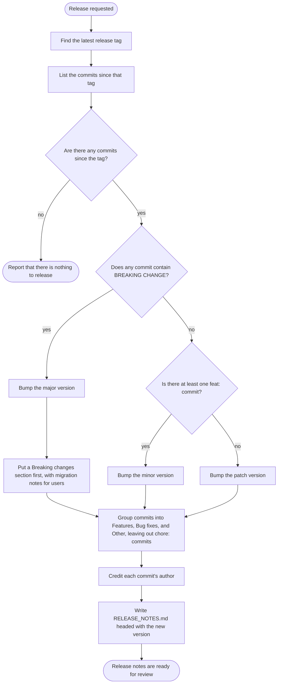

# Release notes process

Our team's process for drafting release notes before a release. Release managers
review the notes and publish the release themselves.

## Rules

- Never create git tags or push; release managers publish the release.
- Link every entry to its commit hash.
